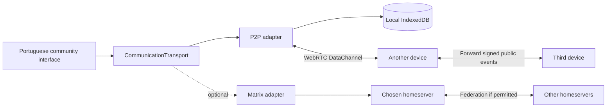

# Architecture v0.1

The interface depends on `CommunicationTransport`, not an SDK-specific room object. P2P is the current default experiment. Matrix and the local demonstration are separate adapters with separate persistence.

## P2P identity and events

Each browser profile creates a P-256 key pair using native Web Crypto. The peer ID is the SHA-256 hash of a canonical public JWK. Identity and private key live in the local IndexedDB; a Web Lock prevents concurrent tabs using the same identity store. There is no account server.

`raiz.events.v1` is an experimental append-only public log. Events have an explicit canonical payload: version, nonce, type, room ID, author ID, author display name, timestamp, body, topic, and reply reference. A SHA-256 payload hash identifies the event, and ECDSA/SHA-256 authenticates its payload. Every received event is validated before persistence or forwarding. Extra fields and any private key material are stripped from received events.

This is an application protocol using standard browser cryptography, not a new cryptographic primitive. No independent security review has been performed. A signed device identity is not a verified human identity.

Community definitions and text messages are event types. Media has a domain representation, but P2P attachments are not implemented. Future media must use content hashes, bounded chunk transfer, integrity checks, and explicit replication/cache policies; do not put large blobs in the text gossip channel.

Events are committed to IndexedDB before entering the visible timeline and outgoing queues. The first version never removes events. Timeline order is `(declared timestamp, event ID)`: peers converge after receiving the same valid events, but clocks are not a global authority. Events more than ten minutes in the future are rejected. There is no total-order consensus, causal conflict-resolution engine, or mutable social feed yet.

## Pairing and transport

Peers exchange signed WebRTC offer and answer codes through an existing trusted channel. Codes include the SDP, identity, request ID, and timestamp. The answer must match the active offer. Signing covers the DTLS fingerprint in the SDP. This protects against unnoticed modification of a code, but replacing the whole code with another valid identity cannot establish who a person is; trusted identity verification remains future work.

All ICE candidates are gathered into the code; no signaling server is contacted. Codes may reveal network addresses. No public STUN/TURN defaults are used. Operators can configure their own ICE servers, including TURN credentials, for new connections. TURN is an optional packet relay and does not store the event log.

WebRTC encrypts each connection with DTLS. All public communities are replicated to all paired peers. Relays in the application graph can read public events; there is no private-group E2EE. A browser statistics check reports whether ICE selected a direct or relayed path when available.

On connection, each side sends bounded inventories of event IDs. A receiver requests IDs it lacks. The sender streams those signed events with backpressure. Newly accepted events are forwarded to other connected peers, retaining the original signature. ID deduplication prevents normal relay loops. There are no delivery receipts or automatic routing to an offline device.

## Scaling and reliability work

Current replication is appropriate for a small trusted experiment, not a network where every user receives everything. Before a 50–100-person pilot:

- Scope replication to communities and make membership/authorization explicit.
- Add invitation links and replace manual signaling with optional, replaceable rendezvous services.
- Evaluate store-and-forward nodes or mailboxes with a clear retention and trust model.
- Add group encryption through a reviewed implementation and identity verification; keep public and private room behavior clear.
- Add recovery, blocking, spam controls, redaction semantics, and storage eviction rules.
- Test mobile background suspension, browser persistence, reconnection, and actual networks in Brazil.

At larger scales, evaluate a supported libp2p stack, peer discovery, bounded-degree topologies, per-community gossip, indexing, and archival nodes. Do not assume WebRTC removes bandwidth cost, NAT traversal, or relay requirements. Preserve replaceable transport boundaries, but do not assume a future P2P network will interoperate with Matrix without a deliberately designed bridge.

## Optional Matrix

The Matrix adapter uses the official JS SDK, standard rooms, `m.room.message`, and `m.in_reply_to` relations. It refuses encrypted-room sending and does not initialize a partial crypto implementation. Public/private group semantics and encryption must be delivered together with full device verification and recovery in a later milestone.

The provided Synapse/PostgreSQL stack is isolated development infrastructure. It does not make the P2P path dependent on PostgreSQL. Integration with MSG Gov requires institutional authorization and encryption compatibility, and is not implemented.

## Primary references checked on 6 October 2026

- [Matrix specification and architecture](https://spec.matrix.org/latest/)
- [Matrix P2P experiments](https://www.matrix.org/blog/2020/06/02/introducing-p2p-matrix/)
- [WebRTC data channels, buffering, and link encryption](https://developer.mozilla.org/en-US/docs/Web/API/WebRTC_API/Using_data_channels)
- [Native Web Crypto signatures](https://developer.mozilla.org/en-US/docs/Web/API/SubtleCrypto/sign)
- [Official Matrix JavaScript SDK](https://github.com/matrix-org/matrix-js-sdk)
- [Synapse installation and PostgreSQL](https://element-hq.github.io/synapse/latest/setup/installation.html)
- [Insight Lab confirms MSG Gov's Matrix use](https://www.insightlab.ufc.br/professor-jose-macedo-fala-sobre-o-msg-gov-em-entrevista-ao-programa-questao-de-ordem-da-alece/)
- [MSG Gov access restrictions and extra encryption](https://web-dvcom.df-1.estaleiro.serpro.gov.br/termos-de-uso)
